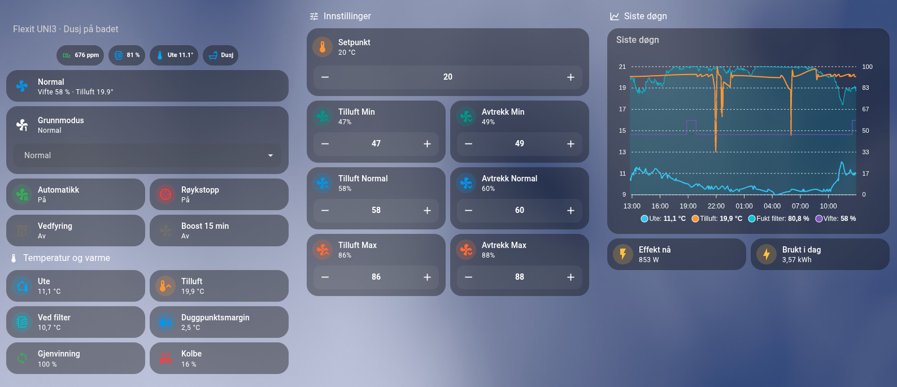
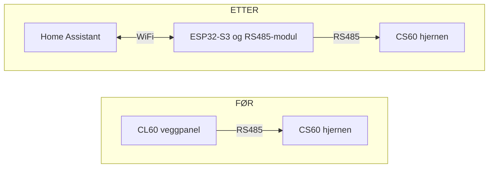
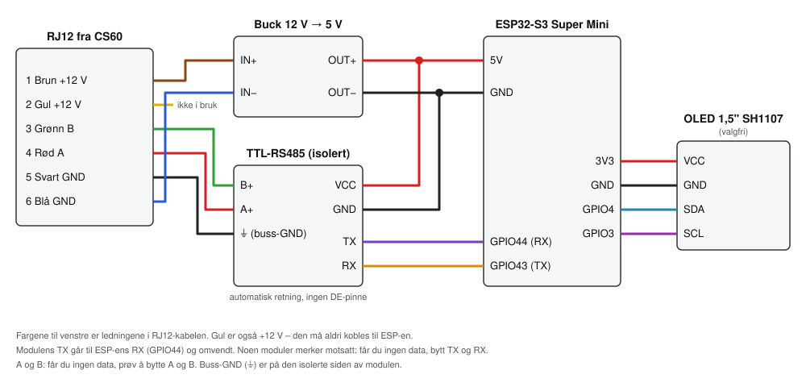
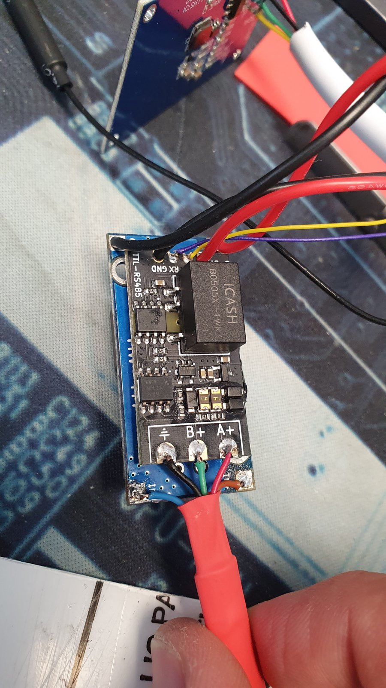
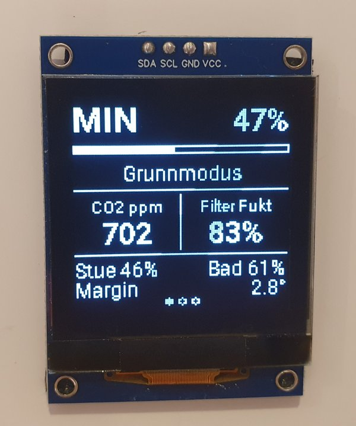
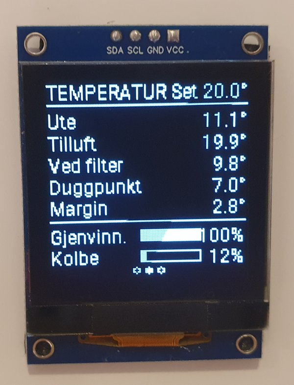

<h1 align="center">Flexit UNI3 × ESPHome</h1>

<p align="center">
  <b>Kast det gamle veggpanelet – styr hele Flexit-aggregatet fra Home Assistant.</b><br>
  Full kontroll over tilluft og avtrekk, settpunkt, filter og alarmer.<br>
  100&nbsp;% lokalt, ingen sky. Delene koster noen hundrelapper.
</p>

<p align="center">
  
  
  
  
  
</p>

<p align="center">
  
</p>

*English: ESPHome replacement for the Flexit CL60 wall panel on units with the CS60 controller (e.g. UNI3),
over RS485/Modbus. Docs are in Norwegian – see [Bruk AI som hjelper](#bruk-ai-som-hjelper): any AI assistant
can explain the repo in your language.*

## Hva er dette?

Et Flexit-aggregat har to deler som snakker sammen over en RS485-kabel:

- **CS60** er **hjernen** – styrekortet *inne i* aggregatet. Det styrer viftene, rotoren og varmebatteriet, og
  måler temperaturene. CS60 blir der den er, og du trenger ikke åpne eller endre den.
- **CL60** er **veggpanelet** – knappene og displayet på veggen. **Det er CL60 dette prosjektet erstatter.**

Du kobler fra CL60 og setter inn en ESP32-S3 med en RS485-modul på samme kabel. CS60 tror den snakker med
panelet sitt, mens ESP-en i virkeligheten sender alt videre til Home Assistant – og tar imot kommandoer tilbake.



## Hva du får

**🌀 Full kontroll over viftene.** Sett tilluft og avtrekk hver for seg, i prosent, for Min, Normal og Max. Du
kan balansere huset selv, for eksempel med litt overtrykk når peisen er tent, og justere alt fra mobilen.

**🌡️ Smart styring av settpunktet.** Tillufttemperaturen er et vanlig tall i HA, så automasjonene dine kan
styre den. Den kan følge varmepumpa, senkes om natta, justeres etter strømprisen eller settes ned når du er
borte. Se [eksempelet](#smart-settpunkt).

**🧽 Filter og alarmer uten panelmenyer.** Filteralarmen dukker opp i HA, og du kan sende varsel til mobilen.
Når du har byttet filter, nullstiller du telleren med én knapp. Det samme gjelder de andre alarmene.

**📈 Alt som måles.** Ute- og tillufttemperatur, viftehastighet, varmegjenvinning og varmebatteri, med historikk
og grafer i HA.

**🤖 Automatikk etter behov.** Slå på pakkene du vil ha:
- stoppe viftene ved røyk
- vedfyring med lett overtrykk
- boost
- mer luft ved dusj eller høy CO2
- mindre luft ved regn eller tørr inneluft
- varsling om kondens i aggregatet

**📟 Valgfri skjerm.** En 1,5" OLED ved aggregatet viser drift, temperaturer og vifter. Se [Skjerm](#skjerm).

**🔒 Lokalt.** Alt går mellom ESP-en og Home Assistant på ditt eget nett, uten noen skytjeneste.

**Testet på:** Flexit UNI3 med CS60. Det bør også virke på andre Flexit-aggregater med CS60 og samme type panel.

## Slik virker det

CS60 er «sjef» (Modbus-master) på panelbussen. Omtrent 9 ganger i sekundet sender den hele tilstanden sin, og
den spør panelet om det har noe nytt. ESP-en tar plassen til CL60 og svarer som et panel på **adresse 3**. Den
leser det CS60 sender, og legger kommandoer klare som CS60 henter. Det er ESP-en som eier innstillingene, også
viftehastighetene.

> **Viktig:**
> - **CL60-panelet skal kobles fra.** ESP-en er eneste panel og kjører showet. Kabelen som gikk til panelet,
>   kobles til ESP-en i stedet.
> - **Slå av aggregatet** (strømmen) før du kobler noe på RJ12-kabelen.
> - CS60 leter bare etter paneler (adresse 1–3) i det den starter, så **ESP-en må være på før CS60**. Får ESP-en
>   strøm fra RJ12-kabelen som vist under, ordner dette seg som regel selv. Ellers: slå av aggregatet, vent
>   litt, og slå det på igjen når ESP-en er oppe.

## Deler

| Del | Søkeord / merknad |
|---|---|
| ESP32-S3 Super Mini | «ESP32-S3 Super Mini». Andre ESP32-S3-kort går også, men da må du sjekke pinnene. |
| TTL-RS485-modul | Helst en modul med **galvanisk skille** og **automatisk retning** («TTL to RS485 isolated module», med B0505-DC-DC-omformer på kortet). Den mates med 5 V og gir 3,3 V-signaler til ESP-en. En MAX485/MAX3485-modul med DE/RE-pinne går også, se [DE/RE-pinne](#dere-pinne). |
| Buck-omformer 12 V → 5 V | En liten «mini buck step-down» som tåler 12 V inn. |
| OLED 1,5" 128x128 SH1107 (I2C) | Valgfri. |
| RJ12-kabel (6 ledere) | Kabelen som gikk til CL60-panelet. |

## Kobling



**RJ12 fra CS60** (pinne 1 → 6):

| Pinne | Farge | Signal | Kobles til |
|---|---|---|---|
| 1 | Brun | +12 V | Buck IN+ |
| 2 | Gul | +12 V | **ikke i bruk** (isoleres) |
| 3 | Grønn | B | RS485 B+ |
| 4 | Rød | A | RS485 A+ |
| 5 | Svart | GND | RS485 ⏚ (buss-GND) |
| 6 | Blå | GND | Buck IN− |

**Resten av koblingen:**

| Fra | Til |
|---|---|
| Buck OUT+ (5 V) | ESP 5V og RS485 VCC |
| Buck OUT− | ESP GND og RS485 GND |
| RS485 TX | ESP **GPIO44** (RX) |
| RS485 RX | ESP **GPIO43** (TX) |
| OLED VCC / GND | ESP 3V3 / GND |
| OLED SDA / SCL | ESP **GPIO4** / **GPIO3** |



**Om bildet:**
- Det sorte kortet er RS485-modulen. Den er limt oppå det blå buck-kortet. Modulen har galvanisk skille mellom
  bussiden (A, B og ⏚) og ESP-siden (VCC, GND, TX og RX). Den mates med 5 V og omformer selv signalene til
  3,3 V for ESP-en.
- Nederst kommer RJ12-kabelen inn: svart til ⏚, grønn til B+ og rød til A+ på RS485-modulen. Brun (+12 V) og
  blå (GND) går til buck-kortet under.
- Øverst går fire ledninger til ESP-en: 5 V, GND, TX og RX.
- Modulen styrer sende/motta-retningen selv, så den har ingen DE-ledning.

> **Spenning:** Gul ledning er også +12 V. Den må aldri kobles til ESP-en. Bruker du en annen RS485-modul, må
> du sjekke at den gir 3,3 V-signaler til ESP-en.

## Programvare

Du trenger Home Assistant med **ESPHome Device Builder** (tillegget «ESPHome»), versjon 2026.9 eller nyere.

1. Åpne ESPHome Device Builder, trykk **+ New device** og gi den navnet `flexit-uni3`.
2. Trykk **Edit** på den nye enheten, slett innholdet og lim inn hele [`flexit-uni3.yaml`](flexit-uni3.yaml).
3. Åpne **Secrets** (øverst til høyre) og legg til `flexit_api_key`. Se
   [`secrets.yaml.example`](secrets.yaml.example). Nøkkelen kan du lage med `openssl rand -base64 32`, eller
   kopiere den Device Builder laget for den nye enheten. Den samme nøkkelen brukes også for OTA.
4. Velg hvilke pakker du vil ha med under `packages:` ved å fjerne `#` foran dem, og rett entitets-ID-ene under
   `substitutions:`. Se [Pakker](#pakker).
5. Koble ESP-en til PC-en med USB, og velg **Install → Plug into this computer** første gang. Senere
   oppdateringer går over WiFi.
6. Home Assistant finner enheten selv (Innstillinger → Enheter og tjenester). Trykk **Konfigurer** og lim inn
   API-nøkkelen. Pakkene som bruker sensorer fra HA (røyk, dusj, CO2 osv.) får verdiene først når enheten er
   lagt til her.

Koden hentes fra dette repoet (`github://galvheim/esphome-flexit-uni3@main`) og oppdateres når du kompilerer.
Vil du heller ha en fast versjon, bytter du `main` med en commit-hash eller tag. Vil du jobbe med en lokal kopi,
legger du `components/` og `packages/` i ESPHome-mappen og bruker `type: local` og `!include` i stedet.

### Første oppstart

1. Slå av aggregatet, koble fra CL60-panelet og koble RJ12-kabelen til ESP-en. Slå på aggregatet igjen.
   ESP-en starter da før CS60.
2. Åpne loggen i ESPHome (**Logs → Wirelessly**). Hvert minutt kommer en linje som denne:
   ```
   Til adresse 3: oppstartsskann(04)=4 coil-poll(01)=812 les(03)=0 annet=0 | broadcast fra CS60=540
   ```
   - `broadcast` øker: data fra CS60 kommer fram.
   - `coil-poll` øker: CS60 har godtatt ESP-en som panel, og kommandoer virker.
3. Ved første oppstart **overtar ESP-en viftehastighetene anlegget allerede bruker**. Etter det er det
   ESP-en som eier dem, og du endrer dem i HA.

## Skjerm

Med `skjerm.yaml` får du tre sider som veksler hvert 5. sekund: drift, temperatur og vifter. Verdier fra de
valgfrie pakkene vises når pakken er med: CO2 (`co2.yaml`), fukt inne (`torr_luft.yaml`), fukt på badet
(`dusj.yaml`) og fukt, temperatur og duggpunkt ved filteret (`kondens.yaml`). Uten dem viser første side ute- og
tillufttemperatur i stedet. Er margin til duggpunktet under 2°, vises «Kondensfare» invertert.

<p>
  
  
</p>

*Bildene er fra mitt eget anlegg med alle pakkene på. Små forskjeller i tekst og plassering kan forekomme.*

## Pakker

`kjerne.yaml` må alltid være med. De andre er valgfrie og avhenger ikke av hverandre.

| Pakke | Gjør | Trenger (substitution) |
|---|---|---|
| `kjerne.yaml` | Panelet: målinger, modus, settpunkt, vifter, alarmer, bryteren «Automatikk» | – |
| `skjerm.yaml` | OLED 128x128 med tre sider som veksler, se [Skjerm](#skjerm) | `i2c_sda_pin`, `i2c_scl_pin` |
| `roykstopp.yaml` | Stop når røykvarsler går, og tilbake når den er klar. Bryter «Røykstopp». | `royk_entitet` |
| `peis.yaml` | Bryter «Vedfyring»: Normal og senket avtrekk (lett overtrykk) i `peis_min` min | – |
| `boost.yaml` | Bryter «Boost»: Max i `boost_min` min | – |
| `dusj.yaml` | Minst `dusj_modus` når fukten på badet stiger raskt | `bad_fukt_entitet` |
| `co2.yaml` | Minst Normal over `co2_hoy_ppm` | `co2_entitet` |
| `torr_luft.yaml` | Høyst Min når inneluften er under `torr_inn_rh` % | `inne_fukt_entitet` |
| `regn.yaml` | Høyst Min ved regn, yr eller tåke i værvarselet | `vaer_entitet` |
| `kondens.yaml` | Duggpunkt og duggpunktsmargin inne i aggregatet (bare visning) | `aggregat_temp_entitet`, `aggregat_fukt_entitet` |

Alle innstillinger og standardverdier står øverst i hver pakkefil under `substitutions:`. Du overstyrer dem
ved å skrive samme navn i `substitutions:` i din egen `flexit-uni3.yaml`.

**Flere sensorer av samme slag?**
- *Flere røykvarslere:* lag en **Gruppe**-hjelper i HA (Binær sensor-gruppe) og bruk den.
- *Fukt fra flere rom:* lag en hjelper som **kombinerer tilstanden** til flere sensorer (gjennomsnitt) og bruk den.

### Prioritet i automatikken

Hvert minutt velges modus i denne rekkefølgen:

1. **Røyk** → Stop. Gjelder alltid.
2. **Vedfyring** → Normal. Gjelder alltid.
3. **Boost** → Max. Gjelder alltid.
4. Er **Automatikk** på, brukes *grunnmodus* (det du sist valgte i «Sett modus») som utgangspunkt:
   - tørr luft eller regn → høyst Min
   - høy CO2 → minst Normal
   - dusj → minst `dusj_modus`

Automatikken setter aldri Stop av seg selv. Er Automatikk av, styrer du modus selv. Røyk, vedfyring og boost
virker likevel, og går tilbake til forrige modus når de er ferdige.

Sensoren **Automatikk status** viser hva som styrer akkurat nå.

## Home Assistant

Med enhetsnavnet «Flexit UNI3» får du blant annet:

| Entitet | Hva |
|---|---|
| `select.flexit_uni3_sett_modus` | Velg Stop/Min/Normal/Max |
| `number.flexit_uni3_temperatur_innstilling` | Settpunkt for tilluft |
| `number.flexit_uni3_tilluft_min` … `_avtrekk_maks` | Viftehastighet (%) per modus |
| `sensor.flexit_uni3_tilluft_temperatur`, `_uteluft_temperatur` | Temperaturer |
| `sensor.flexit_uni3_tilluft_viftehastighet` | Vifte nå (%) |
| `sensor.flexit_uni3_varmegjenvinning`, `_varmebatteri` | Gjenvinning og varmebatteri (%) |
| `binary_sensor.flexit_uni3_filterbytte` | Filteralarm |
| `switch.flexit_uni3_automatikk` | Automatikk av/på |
| `sensor.flexit_uni3_automatikk_status` | Hva som styrer nå |

Et ferdig dashboard finner du i [`ha-eksempler/dashboard-ventilasjon.yaml`](ha-eksempler/dashboard-ventilasjon.yaml).
Det bruker bare innebygde kort. Hovedbildet øverst er laget med
[Mushroom](https://github.com/piitaya/lovelace-mushroom)-kort fra HACS.

### Smart settpunkt

Settpunktet er en vanlig `number`-entitet, så du kan styre det med automasjoner i HA. Dette eksempelet lar
tilluften følge ønsket temperatur på varmepumpa, 2 grader lavere og aldri under 15 °C:

```yaml
alias: Flexit – settpunkt følger varmepumpa
triggers:
  - trigger: state
    entity_id: climate.varmepumpe
    attribute: temperature
  - trigger: time_pattern
    minutes: /10
actions:
  - action: number.set_value
    target:
      entity_id: number.flexit_uni3_temperatur_innstilling
    data:
      value: "{{ [ state_attr('climate.varmepumpe', 'temperature') | float(21) - 2, 15 ] | max }}"
```

Andre ideer:
- nattsenking med en tidsplan
- lavere settpunkt når strømprisen er høy
- borte-modus når alle har reist
- varsel til mobilen når `binary_sensor.flexit_uni3_filterbytte` blir på

## Feilsøking

| Symptom | Prøv |
|---|---|
| `broadcast fra CS60=0` | Bytt A og B. Sjekk at buss-GND (svart) er koblet. Bytt TX og RX mellom ESP og modul. |
| `broadcast` øker, men `coil-poll=0` | CS60 har ikke funnet ESP-en. Slå aggregatet av og på mens ESP-en er på. Sjekk at CL60-panelet er koblet fra. |
| Verdiene i HA står stille | Ikke senk loggnivået under `DEBUG` (kjent feil, MSkjel issue #16). |
| Skjermen er svart | Sjekk SDA/SCL. Noen skjermer bruker adresse `0x3D` (`skjerm_adresse`). |

Trenger du mer detaljert logg, setter du `logger: level: VERBOSE`. Da logges hver Modbus-ramme som hex.

### DE/RE-pinne

Moduler med MAX485, MAX3485 eller lignende har en DE/RE-pinne som må styres for at ESP-en skal kunne sende.
Koble DE og RE sammen til **GPIO8** (gjerne med 10 kΩ ned til GND), og fjern `#` foran blokken nederst i
`flexit-uni3.yaml`:

```yaml
flexit_modbus_server:
  - id: !extend server
    tx_enable_pin: GPIO8
```

Moduler med automatisk retning (som den på bildet) trenger ikke dette.

## Bruk AI som hjelper

Ingen hus er like, og koden må nesten alltid tilpasses litt: dine sensorer, dine rom, dine terskler. Her er en
AI-assistent som [Claude](https://claude.ai) til stor hjelp. Koden er skrevet for å være lett å lese og har
kommentarer på norsk, så en AI forstår raskt hvordan alt henger sammen.

- **Tilpasning:** Gi AI-en lenken til dette repoet og din `flexit-uni3.yaml`. Fortell hvilke sensorer du har i
  HA, og be den sette opp pakkene og entitets-ID-ene for deg.
- **Nye funksjoner:** Be den lage en ny pakke etter samme mønster. Den kan for eksempel lage en pakke som setter
  krav om Min når strømprisen er høy.
- **Feilsøking:** Lim inn loggen fra ESPHome (gjerne sammendragslinjen med `broadcast` og `coil-poll`) og
  beskriv koblingen din. Da kan den hjelpe deg å finne ut om det er A/B, TX/RX, adresse eller oppstartsrekkefølge.
- **Kodeagenter** som [Claude Code](https://claude.com/claude-code) kan klone repoet, endre filene og kompilere
  for deg.

Eksempel på en melding:

> Her er repoet https://github.com/galvheim/esphome-flexit-uni3. Jeg har en Flexit UNI3 og vil bruke dusj- og
> CO2-pakken. Fuktsensoren på badet heter `sensor.bad_fukt` og CO2-sensoren heter `sensor.stue_co2`. Lag
> `flexit-uni3.yaml` til meg.

Sjekk alltid det AI-en foreslår før du flasher. Spesielt viktig er det med kobling og spenning.

## Takk og lisens

- Modbus-komponenten bygger på [MSkjel/esphome-flexit-modbus-server](https://github.com/MSkjel/esphome-flexit-modbus-server).
  Biblioteket under er [MSkjel/ESP-ModbusRTUServer](https://github.com/MSkjel/ESP-ModbusRTUServer).
  Begge har MIT-lisens. Endringene i denne kopien står øverst i
  [`flexit_modbus_server.cpp`](components/flexit_modbus_server/flexit_modbus_server.cpp).
  MSkjels komponent er skrevet for anlegg med CI600-panel; her brukes den i stedet for CL60.
- Lisens: [MIT](LICENSE).
- Dette er et hobbyprosjekt uten tilknytning til Flexit. Bruk på eget ansvar. Røykstopp-funksjonen er ikke et
  godkjent brannsikringssystem.
